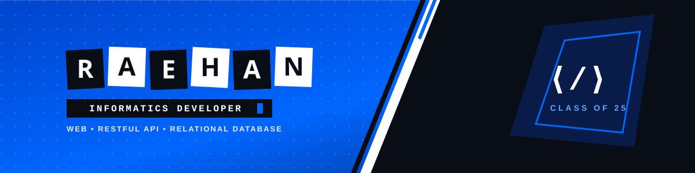
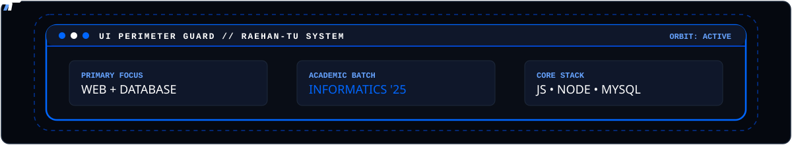
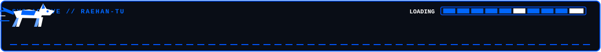

  <!-- 1. ANIMASI BANNER GELOMBANG & LASER -->
  

  <!-- 2. ANIMASI TEKS KETIKAN (TYPEWRITER) -->
  

   

  <!-- BARIS BADGE IDENTITAS -->
  

    
    
    
  

<!-- 3. PEMISAH NEON PULSE -->

<!-- BAGIAN TWO-COLUMN: WHO AM I? + 4. ANIMASI EMBLEM EQUALIZER -->
<table>
  <tr>
    <td width="36%" align="center" valign="middle">
      
    </td>
    <td width="64%" valign="top">
      <h3 align="center">Who Am I?</h3>
      

        I am an <b>Informatics Engineering</b> undergraduate student (Class of 2025) at <b>Tadulako University</b>, driven by a strong interest in <code>Web Development</code>, <code>Software Engineering</code>, and <code>Relational Databases</code>.
      

      

        Over time, I have built practical projects ranging from <b>Point of Sale (POS)</b> web applications and <b>Node.js</b> systems to <b>MySQL</b> database schemas and <b>Geographic Information Systems (GIS)</b>.
      

      

        Currently, I am focused on writing clean, modular code and sharpening my problem-solving skills in <code>JavaScript</code>, <code>Node.js</code>, <code>C++</code>, and <code>MySQL</code>.
      

    </td>
  </tr>
</table>

<!-- TAUTAN SOSIAL -->

  
<b>You can Click here</b>

  
  
  
  

 

<!-- CALLOUT BIRU -->
> [!NOTE]
> Code is never finished, it only gets better.
>
> What you see here is built with practice, curiosity, and persistence.

 

<!-- 5. ANIMASI HEWAN MENGELILINGI KOTAK UI -->

  

 

<!-- 6. ANIMASI CYBER-WOLF & HUD LOADING BAR -->

  

 

<!-- 7. ANIMASI LIVE TELEMETRY, RADAR RINGS & SKILL BARS -->

  <h3>System Telemetry &amp; Skill Load</h3>
  

 

<!-- GRAFIK KONTRIBUSI BIRU -->

  <h3>My Contributions</h3>
  

 

<!-- BAGIAN BAWAH: TECH STACK & GITHUB STATS -->
<table>
  <tr>
    <td width="42%" align="center" valign="top">
      <h4>My Tech Stack</h4>
      

        
        
        
      

      

        
        
        
      

      

        
        
        
      

    </td>
    <td width="58%" align="center" valign="top">
      <h4>GitHub Statistics</h4>
      
        
      
    </td>
  </tr>
</table>
